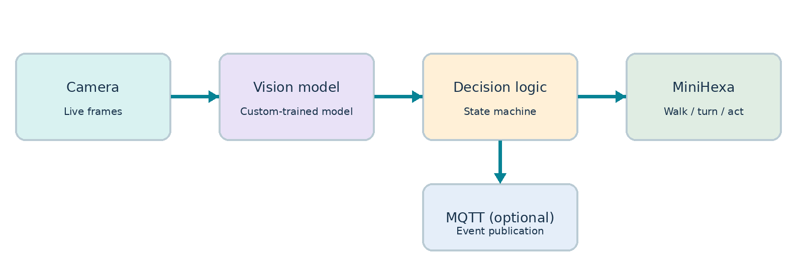
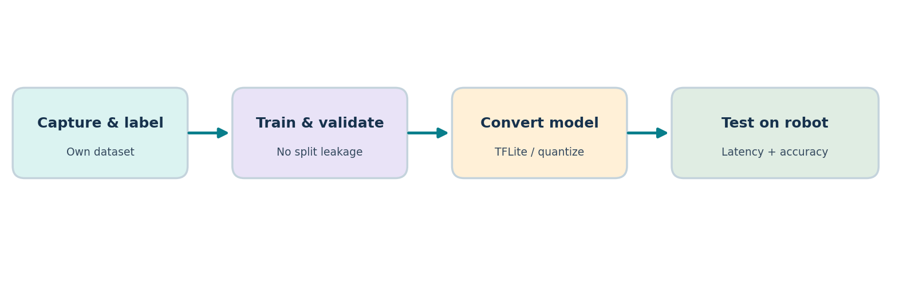
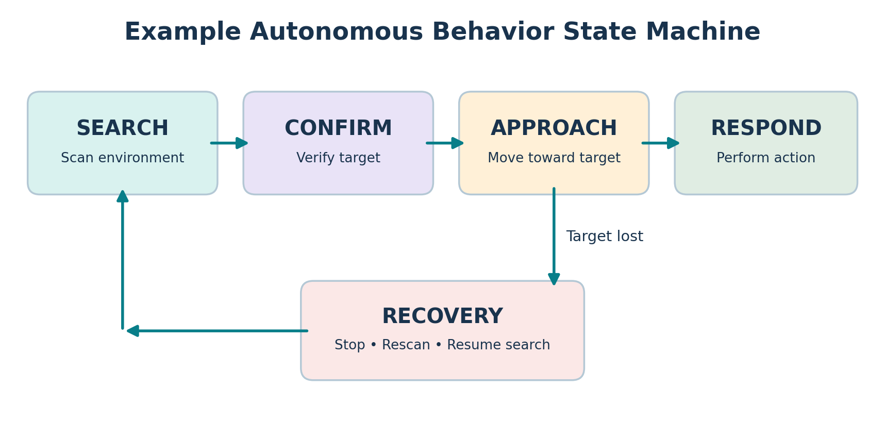

# MiniHexa Autonomous Vision Robot — Repository Guide

This repository contains two reference projects for the **Hiwonder MiniHexa** hexapod: a camera-based image classifier and a movement controller. They demonstrate how a robot can perceive an object, approach it, and perform a predefined movement. Use these implementations as starting points for your own COE476 application; consult the separate course project brief for formal requirements and deliverables.

## Demo Video
The following video demonstrates the MiniHexa autonomously navigating its environment, detecting a punching bag using computer vision, approaching the target, and executing a predefined movement.

https://github.com/user-attachments/assets/07b867d7-3205-4a19-8d94-7e3927bb8069


## Reference projects at a glance

| Detail | `MiniHexa_Controller` | `MiniHexa_Camera_AI` |
|---|---|---|
| Role | Navigation, ultrasonic distance sensing, robot movement, action groups | Image capture, image preprocessing, neural-network inference, detection reporting |
| Hardware target | MiniHexa ESP32-based robot controller | ESP32-S3 with OV2640 camera and PSRAM |
| Framework | **Arduino** (`framework = arduino`) | **ESP-IDF** (`framework = espidf`) |
| Development environment | PlatformIO (VS Code recommended) | PlatformIO (VS Code recommended) |
| PlatformIO board | `esp32dev` | `esp32-s3-devkitc-1` |
| Main source | `src/main.cpp` | `src/main.cpp` |
| Libraries / components | Arduino core; `Wire`; bundled `lib/Hiwonder`, `lib/MiniHexa`, and `lib/Kinematics` | ESP-IDF/FreeRTOS; `espressif/esp32-camera`; `espressif/esp-tflite-micro` (which depends on `esp-nn`); I²C slave driver |
| Dependency declaration | `platformio.ini`; local `lib/` source | `src/idf_component.yml` |
| Sensor inputs | Ultrasonic distance via `minihexa.sensor.get_distance()`; camera detection via I²C | OV2640 RGB565 camera frames |
| I²C role | Master; SDA GPIO 22, SCL GPIO 23 | Slave; SDA GPIO 47, SCL GPIO 48, address `0x52` |
| Data exchanged | Reads 1 byte: `0` = no bag, `1` = bag detected | Sends 1-byte `detection_flag` |
| Example response | Approach detected target, stop within 150 mm, run combat action | Classify camera frame and set detection flag |
| Main extension points | Navigation logic, distance thresholds, action selection, recovery, MQTT | Dataset/model, image preprocessing, output interpretation, communication payload |

> **Important:** These are **PlatformIO projects**. The controller uses the **Arduino framework**; the camera uses **ESP-IDF**. You do not need to create a conventional `.ino` sketch or a separate Arduino IDE project.

## How the two projects work together



1. The ESP32-S3 camera captures an RGB565 image at 160 × 120 pixels.
2. The camera application resizes it to **96 × 96 RGB** and quantizes values to the model's INT8 input format.
3. TensorFlow Lite Micro runs inference and computes a bag probability.
4. A probability of **0.70 or higher** sets the detection flag to `1`; otherwise it is `0`.
5. The controller reads that flag over I²C and independently measures ultrasonic distance.
6. When a target is detected and is farther than **150 mm**, the robot approaches it. At or within **150 mm**, it stops and runs the selected combat action group. The attack is re-armed when distance reaches **200 mm**.

This reference implementation performs **binary classification**, not bounding-box localization or full autonomous exploration. More advanced search, obstacle avoidance, localization, and recovery behavior are possible extensions.

## Project 1 — MiniHexa_Controller

### Setup

1. Install **Visual Studio Code** and the **PlatformIO IDE** extension.
2. Open the `MiniHexa_Controller` folder as a PlatformIO project.
3. Confirm `platformio.ini` selects `esp32dev` and `framework = arduino`.
4. Keep the supplied `lib/Hiwonder`, `lib/MiniHexa`, and `lib/Kinematics` folders. The build configuration explicitly links the kinematics library with `-L` and `-lkinematics`.
5. Connect the MiniHexa controller, select the correct serial port, then **Build** and **Upload** through PlatformIO.
6. Open the serial monitor at the baud rate used by `Serial.begin(115200)`.

### Key files and functions

| File / function | Purpose |
|---|---|
| `src/main.cpp` | Application logic for target approach and combat response |
| `platformio.ini` | Arduino/ESP32 board configuration and kinematics linker flags |
| `lib/Hiwonder/hiwonder_robot.h` | `Robot` interface and movement/action-group methods |
| `lib/Hiwonder/hiwonder_sensor.h` | Ultrasonic distance access |
| `lib/MiniHexa/` | Bundled device and sensor support |
| `lib/Kinematics/` | Kinematics library linked by the project |
| `data/ActionGroup7.rob`, `data/ActionGroup8.rob` | Provided robot action-group files; availability on the robot must be checked |
| `minihexa.begin()` | Initializes the robot |
| `minihexa.move(...)` | Commands robot motion |
| `minihexa.action_group_run(...)` | Runs a stored movement sequence |
| `minihexa.sensor.get_distance()` | Reads ultrasonic distance in millimeters |
| `readDetection()` | Reads and validates the camera's 1-byte I²C response |

The current active configuration selects **action group 8** (`COMBAT_ACTION = 8`); the comment indicates changing this to `7` for Combat 1. Check that the selected action group is available on the robot using `minihexa.list_action_group_dir()`.

### Wiring and communication

| Signal | Controller | Camera |
|---|---|---|
| SDA | GPIO 22 | GPIO 47 |
| SCL | GPIO 23 | GPIO 48 |
| Ground | GND | GND |
| I²C address | Requests from `0x52` | Responds at `0x52` |

Connect a **common ground**, use compatible **3.3 V I²C logic**, and check whether suitable pull-ups are already fitted. Do not connect incompatible voltage levels directly.

## Project 2 — MiniHexa_Camera_AI

### Setup

1. Open `MiniHexa_Camera_AI` in **VS Code + PlatformIO**.
2. The project uses `framework = espidf` with the `esp32-s3-devkitc-1` board target.
3. The `src/idf_component.yml` declares `espressif/esp-tflite-micro` and `espressif/esp32-camera`; PlatformIO/ESP-IDF resolves their dependencies.
4. The provided configuration specifies **8 MB flash**, QIO flash mode, and **OPI PSRAM**. Verify these settings against the actual camera board.
5. Build and upload the application, then open the serial monitor at **115200 baud**.
6. Confirm that camera initialization, I²C initialization, PSRAM tensor allocation, and inference succeed.

### Main dependencies

| Component | Purpose | Evidence in project |
|---|---|---|
| ESP-IDF / FreeRTOS | Application entry point, tasks, memory management | `app_main`, FreeRTOS includes |
| `espressif/esp32-camera` | OV2640 camera capture | `esp_camera.h` and component manifest |
| `espressif/esp-tflite-micro` | On-device neural-network inference | TFLM headers and component manifest |
| `espressif/esp-nn` | Optimized neural-network operations | Transitive dependency of TFLM |
| ESP-IDF I²C slave driver | Sends the detection byte | `driver/i2c_slave.h` |
| `src/model_data.h` | Embedded model byte array | Included directly by `main.cpp` |

The uploaded dependency snapshot includes `esp32-camera` **2.1.8**, `esp-tflite-micro` **1.4.1**, and `esp-nn` **1.4.1**. The manifest uses `*` version constraints, so a fresh dependency resolution may select other versions. Pin versions if reproducibility is important.

### Camera and model configuration

| Parameter | Current value |
|---|---|
| Camera format | RGB565 |
| Capture resolution | QQVGA, 160 × 120 |
| Neural-network input | 96 × 96 × 3, signed INT8 |
| Tensor arena | 512 KB, allocated in PSRAM |
| Detection threshold | `0.70` |
| Supported operators registered | Conv2D, MaxPool2D, Mean, FullyConnected, Logistic |
| Camera-to-controller output | Single detection byte (`0` or `1`) |
| I²C slave address | `0x52` |

### Where to change the model

The existing `src/model_data.h` contains the embedded model bytes. To use a new model:

1. Collect and label images for the chosen application.
2. Train and evaluate a classifier using your own dataset.
3. Convert the trained network to a **fully INT8-quantized TFLite** model compatible with TensorFlow Lite Micro.
4. Convert the `.tflite` binary to a C/C++ byte array and replace the model data in `src/model_data.h` (retaining the symbol expected by the code).
5. Update `camera_frame_to_input()` if input shape, channel order, or preprocessing changes.
6. Update the `MicroMutableOpResolver` if the new model uses different operators.
7. Update the output interpretation and threshold if the model is multiclass or has a different output layout.
8. Rebuild, flash, and test on the actual camera hardware.



**Model training and conversion scripts are not included in these two uploaded project folders.** The camera project contains a deployed model header and inference code, not the original training dataset or notebook.

## Extending the application

The two projects are intended as references, not a complete solution for every application. Possible extensions include search patterns, target reacquisition, multiple object classes, different physical reactions, safer obstacle avoidance, and improved confidence handling.



The diagram illustrates a **possible expanded state machine**. It is not a claim that every state is already implemented in the supplied code.

### Optional MQTT

**MQTT is not currently implemented in either uploaded project.** To add it, students would need Wi-Fi/network configuration, an MQTT client, broker details, and a clear event format. For example, publish a detection or completed action to a project-specific topic. Never commit real broker credentials or Wi-Fi passwords to a public repository.

## Troubleshooting

| Symptom | Check |
|---|---|
| Camera initialization fails | Camera pin mapping, power, board variant, PSRAM settings |
| Tensor allocation fails | PSRAM availability and the 512 KB tensor arena |
| Model fails to initialize | INT8 input, model schema, supported operators, tensor arena size |
| Controller always reads no target | Shared ground, I²C SDA/SCL wiring, address `0x52`, camera logs |
| Robot does not approach | Detection flag, ultrasonic reading, 150 mm threshold, robot initialization |
| Action does not execute | Selected action group (7/8), stored action-group availability, robot state |
| Build has hundreds of generated files | Exclude `.pio/`, `build/`, and `managed_components/` from Git; retain manifests and source |

## Repository hygiene

Keep application source, manifests, local libraries, model files, and required action-group files. Avoid committing generated build outputs or downloaded managed dependencies. A suitable root `.gitignore` includes:

```gitignore
**/.pio/
**/build/
**/managed_components/
**/.vscode/
**/sdkconfig.old
```

If you change framework versions or board settings, record those changes in your project documentation. Test robot movements with adequate clearance and be ready to disconnect power.
