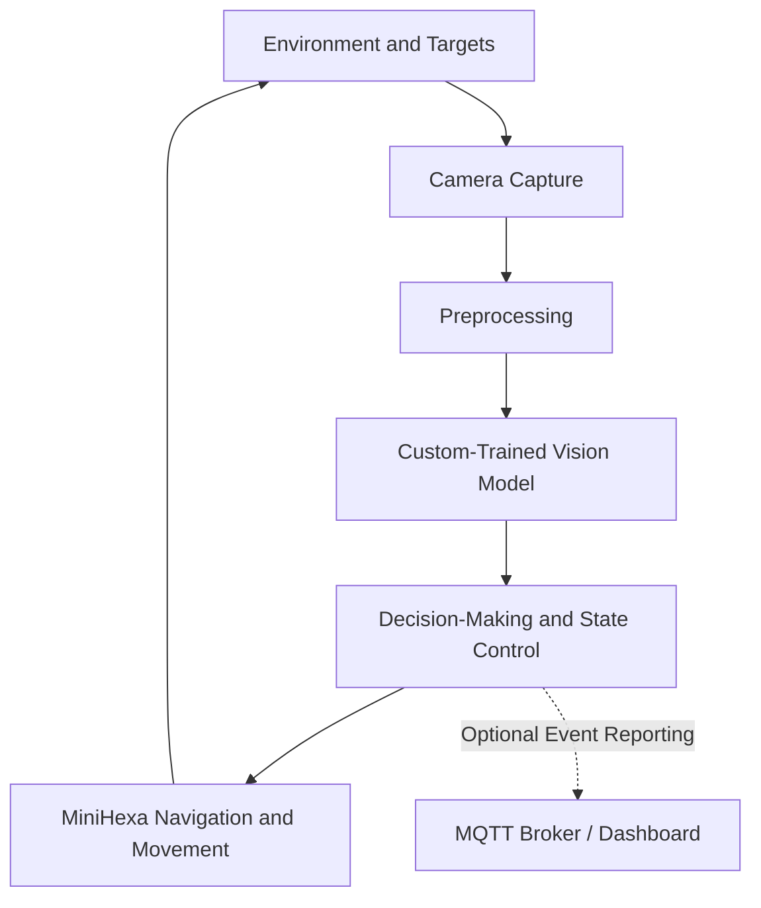
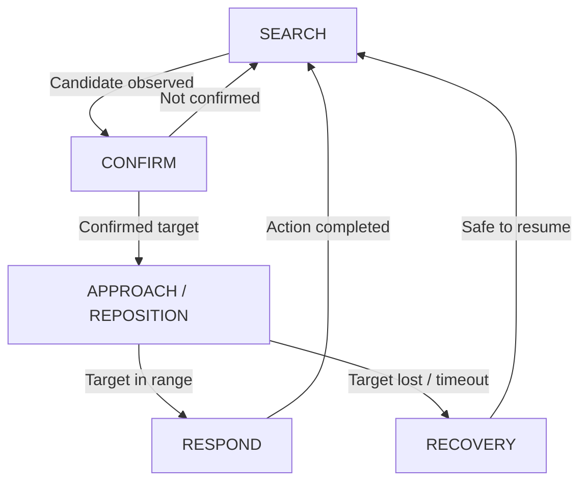

# Minihexa_AI_Project
This is intended to be used as a guide for COE476 projects using the hiwonder Minihexa
# COE476 — Autonomous Vision-Based MiniHexa Robot

> **Course project** · Computer Vision · Embedded AI · Autonomous Control

## 1. Project Overview

Design and implement an autonomous application using the **Hiwonder MiniHexa hexapod robot**. The robot must move through a bounded environment, search for and visually identify an application-specific target or condition, and respond with a purposeful physical action. It must operate as an integrated **perception–decision–action** system, not as a manually triggered sequence of movements.

The existing punching-bag tracking and battle-action demonstration is a **reference implementation**, not the final project to reproduce. Each team must propose a distinct mission, collect its own training data, train and evaluate its own model, and integrate its results with robot behavior. MQTT communication may optionally report detections and completed actions.

## 2. Learning Outcomes

- Design a testable autonomous robotics mission with clearly defined success and failure conditions.
- Collect, label, split, and document an original image dataset representative of the intended environment.
- Train and evaluate a compact vision model and deploy it using an appropriate inference runtime.
- Connect model predictions to navigation, movement, and recovery logic.
- Measure end-to-end reliability, inference latency, and performance under changed conditions.

## 3. System Architecture

The camera captures frames during navigation. A preprocessing stage prepares each frame for the custom-trained model. The decision module interprets predictions using confidence thresholds, temporal confirmation, and mission rules, then issues commands to the MiniHexa movement controller. The process repeats continuously so actions remain responsive to the environment.

## 4. Minimum Functional Requirements

| Component | Required behavior / evidence |
|---|---|
| Autonomous navigation | Search or patrol without continuous manual steering; turn, move, and adjust according to mission state. |
| Custom-trained vision model | Train a model on collected or curated images and report held-out evaluation. |
| Detection / classification | Identify the intended target or condition; explain localization if steering toward a target. |
| Decision-making | Map confidence and observations to commands; mitigate false positives. |
| Physical response | Execute a purposeful movement, such as approach, retreat, gesture, avoidance, or action group. |
| Recovery behavior | If the target is lost or confidence is low, stop, re-scan, or return safely to search. |
| MQTT (optional) | Publish structured detection or action events; not required for completion. |

## 5. Example Project Directions

### A. Target Tracking and Interaction

Search for a specified target, align with it using camera observations, approach within a safe distance, and perform an interaction gesture or action group. For example, locate a training pad and execute a **non-contact** battle demonstration. Test target displacement, distractors, and partial occlusion.

### B. Visual Inspection Patrol

Patrol a marked test area and classify visual markers or simulated defects (e.g., normal versus warning marker). Stop to inspect, perform different gestures for different classes, and optionally publish an inspection result. Demonstrate repeated inspections at different positions.

### C. Object-Aware Navigation

Identify two or more object categories and choose whether to approach, avoid, or stop. For example, approach a designated station but turn away from a restricted marker. Evaluate decision correctness and collision-free operation.

### D. Search-and-Respond Mission

Search for one target among distractors, confirm the target across multiple frames, and perform a class-specific movement. For example, find an emergency marker and signal its discovery with a gesture and optional MQTT message.

Alternative applications with equivalent technical depth may be proposed for approval.

## 6. Model Training and Deployment

1. Define target classes, intended use case, image resolution, and anticipated lighting/background variation.
2. Collect and label a varied dataset. Keep near-duplicate video frames from leaking across training, validation, and test sets.
3. Train a compact model using a documented architecture and reproducible configuration.
4. Evaluate on held-out data using a confusion matrix, precision/recall or accuracy, failure examples, and detection metrics where relevant.
5. Export to `.tflite`, compare predictions against the original model, and measure inference time on the deployment hardware.
6. Integrate preprocessing, label mapping, confidence thresholds, and inference into the robot’s control loop.

**Deployment note:** Standard TensorFlow Lite is generally appropriate for Raspberry Pi/Linux. TensorFlow Lite Micro targets supported microcontrollers and may require compatible operators, memory planning, and C-array export. A classifier predicts classes but does not necessarily provide object coordinates; teams steering toward a target must explain their localization strategy.

## 7. Navigation, Decisions, and Recovery

A typical controller begins in **SEARCH**, scanning the environment or following a safe patrol. A candidate target enters **CONFIRM** only after sufficient confidence or repeated observations. The robot then **APPROACHES** or repositions before **RESPONDING**. If the target disappears, inference becomes uncertain, or movement times out, it enters **RECOVERY** and resumes searching safely. Teams may adapt the states to their missions.

## 8. Starter Materials

The following reference materials may be made available separately:

- MiniHexa punching-bag vision/tracking application and existing integration patterns.
- Robot motion-control examples and compatible battle/action-group (`.rob`) assets.
- Camera capture, frame preprocessing, and model-inference scaffolding.
- Keras-to-TFLite conversion templates, with optional INT8 quantization and C-array export.
- Optional MQTT publishing example and suggested JSON fields: `timestamp`, `class`, `confidence`, `state`, and `action`.

Starter assets are references, **not substitutes for a team’s own trained model or original application**. Identify reused code, explain modifications, and document hardware and library dependencies. Working source and action-group files will be shared separately.

## 9. Implementation and Testing Plan

| Stage | Expected checkpoint |
|---|---|
| Proposal | Mission, target classes, environment, success criteria, block diagram, risks. |
| Model milestone | Labeled dataset, training results, held-out evaluation, exported TFLite model. |
| Integration milestone | Camera inference triggers at least one controlled MiniHexa movement. |
| Autonomy milestone | Robot searches, confirms, reacts, and handles lost targets without manual steering. |
| Final demonstration | Multiple trials, success rate, timing, error analysis, complete code and report. |

Recommended tests include different distances and orientations, changed lighting, distractors, target removal, and repeated runs. Report successful trials out of total trials, average inference time, and common failures—not only the best demonstration.

## 10. Deliverables

1. **Project proposal:** Mission, objectives, planned classes, navigation strategy, block diagram, and division of responsibilities.
2. **Training package:** Dataset description and splits, training script/notebook, evaluation plots, exported model, and label mapping.
3. **Software:** Robot control code, inference code, modified action-group assets if applicable, dependencies, and setup instructions.
4. **Live demonstration and short video:** End-to-end autonomous mission with a perception-triggered response and recovery from a missed target.
5. **Final technical report:** Architecture, methodology, results table, failure analysis, limitations, and individual contributions.

## 11. Evaluation Focus

| Area | What will be assessed |
|---|---|
| Model development | Training workflow, evaluation, reproducibility, and appropriate model choice. |
| Autonomous behavior | Meaningful navigation, clear decisions, and reliable recovery. |
| System integration | Correct connection of vision, robot control, and optional messaging. |
| Experimental validation | Repeated tests, quantitative evidence, and failure analysis. |
| Documentation and demonstration | Readable code, coherent report, convincing end-to-end demonstration. |

Exact grade weights and deadlines will be announced separately. **MQTT is optional** and does not replace the core vision-and-motion functionality.

## 12. Safety, Scope, and Constraints

- Operate in a bounded, supervised test area with a clear stop mechanism.
- Avoid forceful impacts, unstable surfaces, stairs, people, and fragile objects.
- Keep action groups and servo movements within tested hardware limits; verify movements before integrating autonomous logic.
- Choose a mission achievable with available camera, compute hardware, and project time.
- Document external compute, network, or MQTT dependencies; the core mission should work without MQTT.

> **Key requirement:** The project is assessed as an autonomous system. A high-accuracy model without navigation and a meaningful physical response is incomplete. Likewise, a preprogrammed motion sequence without custom-trained perception does not meet the requirements.
